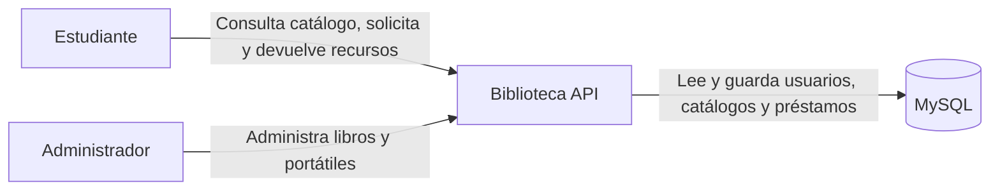
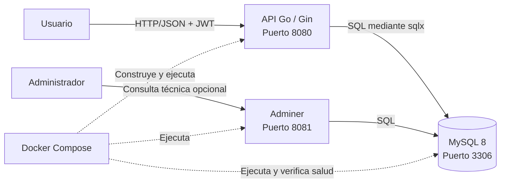
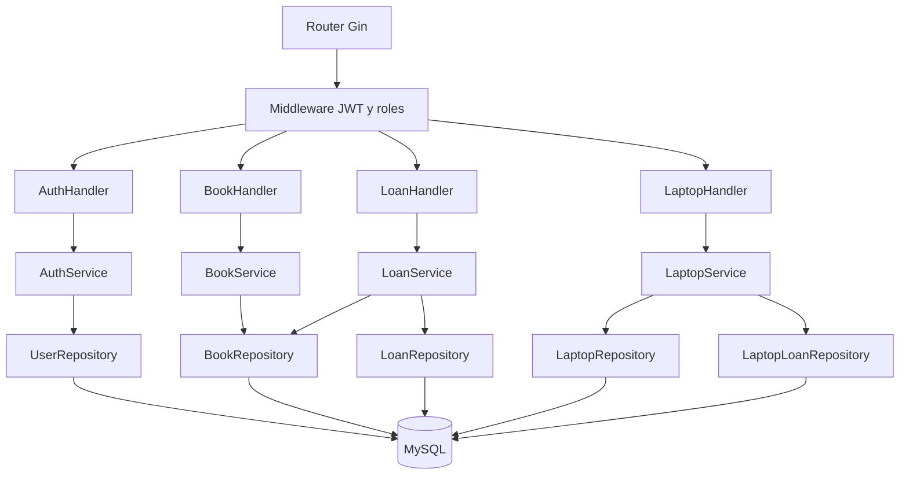
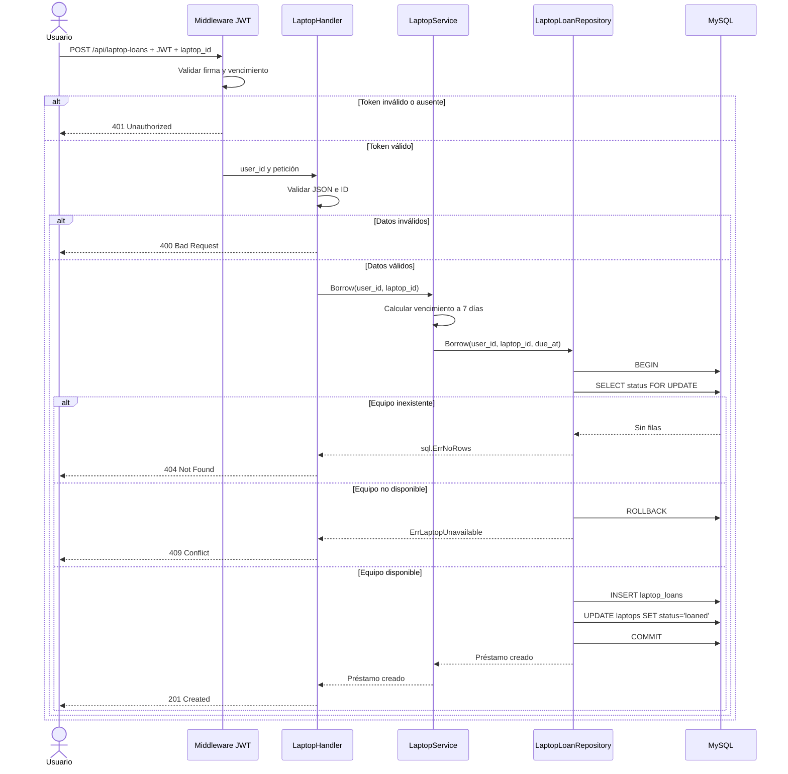

# Diagramas de arquitectura

**Autor:** Carlos Antonio Ramírez Galvis

## C4 nivel 1: contexto del sistema

La API es el sistema central. Los dos tipos de usuario acceden mediante HTTP y la aplicación guarda su información en MySQL.

## C4 nivel 2: contenedores

Docker Compose coordina los tres contenedores. La API no expone directamente la base de datos a sus clientes; toda regla de negocio pasa por Go.

## Diagrama de componentes de la API

Los handlers traducen HTTP, los servicios expresan los casos de uso y los repositorios contienen SQL. El módulo nuevo respeta la estructura que ya tenía el proyecto.

## Secuencia: solicitar un portátil

